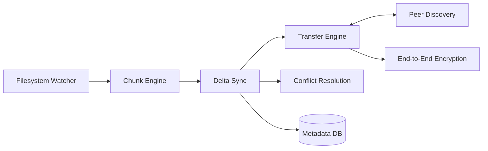

<div align="center">


# SecureSync

Encrypted peer-to-peer file synchronization, built from scratch in Python.

[](https://github.com/Abolfazlrwm/SecureSync/actions/workflows/ci.yml)
[](https://codecov.io/gh/Abolfazlrwm/SecureSync)
[](LICENSE)
[]()
[](https://github.com/psf/black)
[]()

</div>

## What is SecureSync?

SecureSync keeps a folder in sync between two devices on the same network
without a central server. Devices find each other through mDNS,
authenticate each other with Ed25519 identity keys, and exchange file data
over an AES-256-GCM encrypted TCP connection. Transfers are delta-based:
only the chunks that actually changed cross the network.

This is a working program, not a sketch. The end-to-end test
([tests/integration/test_end_to_end_sync.py](tests/integration/test_end_to_end_sync.py))
boots two independent instances, syncs a file from one to the other over
real TCP with real crypto, and checks the result byte for byte. It runs in
CI on every push.

## Architecture

The codebase follows Clean Architecture: the domain layer (chunking, delta
calculation, conflict resolution, version vectors) has no knowledge of the
filesystem, the network, or the database. Every adapter (TCP transport,
cipher, mDNS discovery, SQLite storage) sits behind a port defined in the
domain, so any of them can be swapped without touching the core logic.

Full write-up: [docs/architecture.md](docs/architecture.md)



## Features

- Real-time filesystem watching (create/modify/delete/rename/move)
- Streaming, bounded-memory chunking with SHA-256 content hashing
- Delta synchronization: only changed chunks are transferred
- Peer discovery over mDNS (zeroconf)
- TCP transfers with AEAD-encrypted binary wire protocol
- X25519 key exchange, AES-256-GCM and ChaCha20-Poly1305 ciphers
- Trust-on-first-use peer authentication with Ed25519 identities
- Conflict detection with version vectors and pluggable merge strategies
- SQLite-backed metadata store (files, chunks, version history)
- Synchronization orchestrator with a state machine and lifecycle control
- Version-aware sync direction (PUSH / PULL / CONFLICT / NOOP)
- Autonomous push receiver: incoming pushed files are reconstructed on
  their own, with no manual step on the receiving side
- CLI (`securesync` init / config / peers / sync / pull / daemon / trust)
- YAML configuration with production bootstrap and signal handling
- 732 tests, 95% coverage, property-based tests for the decoders and the
  chunk engine, and a dedicated security test suite (path traversal,
  replay, handshake impersonation)

## Installation

Requires Python 3.12 or newer.

```bash
git clone https://github.com/Abolfazlrwm/SecureSync.git
cd SecureSync
pip install -e ".[dev]"
```

## Quick Start

On each device:

```bash
# Create a device identity and a default config
securesync init --storage-dir ~/.securesync

# Show current configuration (secrets redacted)
securesync config

# List known peers and their trust status
securesync peers

# Start the sync daemon (discovers peers, syncs automatically)
securesync daemon
```

To sync a specific file to all discovered peers right away:

```bash
securesync sync path/to/file.txt
```

To pull a file from a specific peer:

```bash
securesync pull path/to/file.txt --from <peer-device-id>
```

After replacing a device or rotating keys, reset trust for it:

```bash
securesync trust <peer-device-id>
```

## Configuration

Configuration lives in a YAML file (default: `config.yaml`). The schema and
all options are documented in [docs/configuration.md](docs/configuration.md).
The main sections are `storage` (sync directory, database path, chunk size),
`network` (handshake, transfer, and manifest ports), `device_id`
(auto-generated if omitted), and `log_level`. Working examples are in
[examples/config](examples/config).

## Documentation

| Doc | Covers |
|---|---|
| [docs/architecture.md](docs/architecture.md) | Layers, design patterns, technology decisions, diagrams |
| [docs/networking.md](docs/networking.md) | Peer discovery, topology, connection lifecycle |
| [docs/protocol.md](docs/protocol.md) | Wire protocol: header layout, packet types, handshake |
| [docs/security.md](docs/security.md) | Cryptographic design and threat model |
| [docs/performance.md](docs/performance.md) | Benchmark methodology and metrics |
| [docs/development.md](docs/development.md) | Local dev setup, testing conventions |
| [docs/deployment.md](docs/deployment.md) | Docker, docker-compose, systemd, ports |
| [docs/configuration.md](docs/configuration.md) | YAML schema, environment variables |
| [docs/troubleshooting.md](docs/troubleshooting.md) | Common issues and diagnostics |
| [docs/adr/](docs/adr/) | Architecture Decision Records |
| [CHANGELOG.md](CHANGELOG.md) | Changes per release |

## Benchmarks

Benchmarks for chunking, hashing, encryption, and the handshake live in
[benchmarks/](benchmarks/). Run them with `make benchmark`. Recorded
results and the methodology are described in
[docs/performance.md](docs/performance.md).

## Roadmap

The short version is in [ROADMAP.md](ROADMAP.md): what works today, what is
next, and what is deliberately out of scope.

## Known Limitations

- The filesystem watcher is implemented and fully tested but is not wired
  into the daemon yet, so a file is not synced automatically the moment
  you save it. Use `securesync sync` for explicit syncs for now.
- No compression, resumable transfers, or bandwidth limiting yet.
- The handshake is a custom SIGMA-style protocol built on audited
  primitives from the `cryptography` library. The primitives are audited;
  the protocol composition is not.
- Conflict handling is last-writer-wins. Concurrent edits to the same file
  are detected, not merged.

## FAQ

**Why not just use Syncthing?**

If you need a production sync tool today, use Syncthing. It is mature,
battle-tested, and does far more than this project. SecureSync is a
smaller tool built to explore how far a from-scratch, cleanly-architected
P2P sync engine can go.

**Is the cryptography audited?**

No protocol-level audit has been done. All primitives come from the
audited `cryptography` (pyca) library: X25519 for key exchange, Ed25519
for identity, AES-256-GCM / ChaCha20-Poly1305 for AEAD. The handshake
wrapping them is a custom construction and should be treated as such.
Details in [docs/security.md](docs/security.md).

## Contributing

See [CONTRIBUTING.md](CONTRIBUTING.md) for the development workflow and
coding standards.

## Security

Report vulnerabilities privately, see [SECURITY.md](SECURITY.md). The full
cryptographic design and threat model is in
[docs/security.md](docs/security.md).

## License

[MIT](LICENSE)
