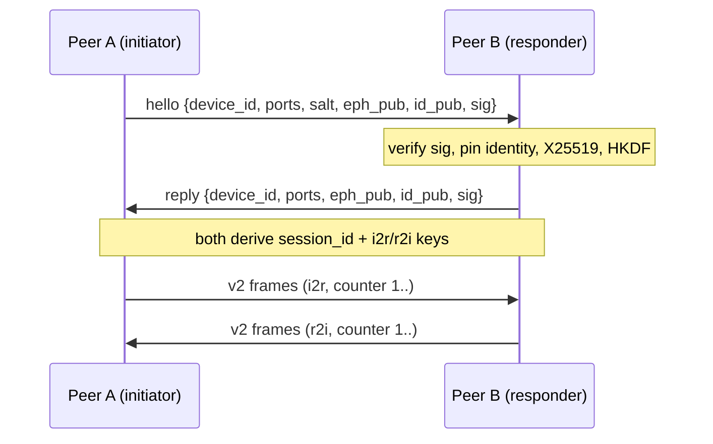
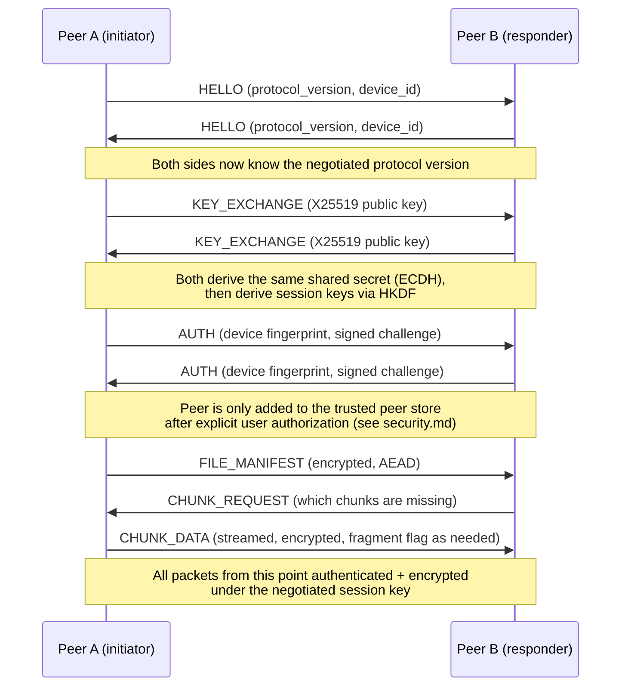

# Protocol

> Status: **v2 implemented** for the transport and manifest paths. The packet
> header below is implemented in `core/protocol.py`; the v2 secure frame that
> wraps it is implemented in
> `infrastructure/networking/replay_protection.py` and
> `infrastructure/networking/secure_channel.py`. Sections that describe
> behaviour not yet built are marked *deferred*.
>
> **Breaking change (Step 1d): protocol version 1 → 2.** v1 and v2 peers do not
> interoperate. A v2 receiver rejects a v1 frame on the plaintext version byte,
> before any decryption, with `UnsupportedVersionError`.

## 1. Design goals

- **Small, fixed-size header** so a receiver can validate and route a
  packet before touching the (potentially large, streamed) payload.
- **Forward compatible** — a peer running a newer protocol version must be
  able to talk to an older one, or fail predictably rather than silently.
- **Payload format decoupled from the header** — the header is a raw,
  hand-packed binary struct (fixed layout, no ambiguity); the payload is
  MessagePack, so new fields can be added to messages without a protocol
  version bump.

## 2. Packet header layout

Fixed 32-byte header, big-endian:

| Field | Type | Size | Description |
|---|---|---|---|
| `magic` | `uint32` | 4 B | Constant `0x53594E43` (`"SYNC"`), rejects non-SecureSync traffic immediately |
| `version` | `uint8` | 1 B | Protocol version. Receivers reject packets with a `version` they don't support, per §4 |
| `packet_type` | `uint8` | 1 B | See §3 |
| `flags` | `uint16` | 2 B | Bitfield: bit 0 = compressed, bit 1 = encrypted, bit 2 = fragment, bits 3–15 reserved |
| `message_id` | `uint64` | 8 B | Unique per session; used to correlate requests/responses and detect replays |
| `payload_length` | `uint32` | 4 B | Length in bytes of the MessagePack payload that follows |
| `timestamp` | `uint64` | 8 B | Sender's Unix timestamp (ms) — replay-window checks, not a trust anchor by itself |
| `crc32` | `uint32` | 4 B | CRC32 over `payload`, integrity check *before* decryption/decompression |

Total: 32 bytes, followed by `payload_length` bytes of (optionally
compressed, optionally encrypted) MessagePack data.

```text
 0        4    5    6         8                        16
 +--------+----+----+---------+------------------------+
 | magic  |ver |type|  flags  |       message_id        |
 +--------+----+----+---------+------------------------+
 16                 20                    28            32
 +-------------------+---------------------+-----------+
 |  payload_length    |      timestamp      |   crc32   |
 +-------------------+---------------------+-----------+
 |                  payload (payload_length bytes)      |
 +--------------------------------------------------------+
```

## 3. Packet types

| Value | Name | Purpose |
|---|---|---|
| `0x01` | `HELLO` | Protocol/version announcement, first packet of a session |
| `0x02` | `KEY_EXCHANGE` | X25519 public key exchange (see `docs/security.md`) |
| `0x03` | `AUTH` | Peer/device authentication, fingerprint verification |
| `0x10` | `FILE_MANIFEST` | Announces a file and its chunk list |
| `0x11` | `CHUNK_REQUEST` | Requests one or more chunks by hash |
| `0x12` | `CHUNK_DATA` | Chunk payload (streamed, may be fragmented — see flag bit 2) |
| `0x20` | `HEARTBEAT` | Keep-alive / liveness check |
| `0x21` | `PEER_LIST` | Gossip of known peers (future: mesh discovery) |
| `0xF0` | `ERROR` | Structured error response |
| `0xFF` | `CLOSE` | Graceful session termination |

## 4. Versioning strategy

- The header's `version` field is a single monotonically increasing
  integer, not semver — the header layout itself only changes on a major,
  deliberately-announced protocol revision.
- Within one header version, **new payload fields are always additive** —
  MessagePack payloads are maps, so a newer sender can add optional keys
  that an older receiver simply ignores.
- A receiver that gets a packet with a higher `version` than it supports
  responds with `ERROR` (`unsupported_version`) rather than attempting to
  parse it — never guess.
- **Version 2** (Step 1d) wraps every packet in the secure frame of §6.1 and
  is a breaking change: a v1 peer's envelope has no version byte in that
  position, so v2 rejects it with `UnsupportedVersionError` before decrypting.

## 5. Handshake sequence

### 5.1 Implemented (v2)

The handshake is a single length-prefixed MessagePack request/response over the
handshake port, not a sequence of `Packet` frames:

1. **Initiator → Responder**: `device_id`, `transfer_port`, `manifest_port`,
   `salt`, ephemeral X25519 `public_key`, long-term Ed25519
   `identity_public_key`, and `signature` over `salt ‖ public_key`.
2. **Responder** verifies the signature, pins the identity key
   (trust-on-first-use), then replies with the same fields plus its own
   ephemeral key, signed over `salt ‖ responder_public_key`.
3. Both sides derive `session_id`, `i2r_key` and `r2i_key` (§6.4).

The initiator's session is confirmed as soon as the signed reply verifies. The
responder's session is confirmed by the first successfully authenticated inbound
frame, which proves the peer actually holds the derived keys.



### 5.2 Target (deferred)

The multi-step `HELLO` / `KEY_EXCHANGE` / `AUTH` exchange below is the long-term
target and is **not** what the code does today. It is part of the item 1e
handshake redesign.



## 6. Integrity and replay protection at the protocol layer

### 6.1 The v2 secure frame

Every message is a 4-byte length prefix followed by this frame:

```text
[version:1][direction:1][packet_type:1][session_id:8][nonce:12][ciphertext:n][tag:16]
```

`version`, `direction`, `packet_type`, `session_id` and `nonce` are plaintext.
`ciphertext` is the AEAD encryption of the full `Packet.encode()` — the 32-byte
header *including* `message_id` and `timestamp`, plus the payload.

There are **no frame magic bytes**: the version byte is the first thing on the
wire, which is what makes the v1 → v2 break detectable before decryption.

### 6.2 Associated data

```text
[version:1][direction:1][packet_type:1][session_id:8]
[sender_id_len:2][sender_id][receiver_id_len:2][receiver_id]
```

`sender_id` is taken from the **authenticated session** (`session.peer_id`),
never from a field inside the packet, so a sender cannot claim another identity
by editing the payload. `receiver_id` is the local device ID on receive and the
peer ID on send. All variable-length fields are length-prefixed; raw
concatenation would let `("ab","cd")` and `("abc","d")` produce identical AAD.

`packet_type` is plaintext and covered by the AAD; after decryption the inner
header's `packet_type` must equal the outer one.

### 6.3 Nonce

```text
[direction:1][counter:8 big-endian][0x00 0x00 0x00]
```

The counter equals `header.message_id` and starts at 1; counter 0 is invalid.
Direction is **role-based**:

| Value | Meaning |
|---|---|
| `0x00` | initiator → responder |
| `0x01` | responder → initiator |

The receiver derives the expected direction from its own role and rejects a
frame carrying any other direction **before decrypting**. Because the nonce is
deterministic, the receiver can recompute it from the plaintext direction and
the decrypted `message_id` and reject a mismatch (`NonceMismatchError`).

### 6.4 Key schedule

HKDF-SHA256, every variable-length field length-prefixed (`lp(x)` = 2-byte
big-endian length ‖ x):

```text
master     = HKDF(shared_secret, salt, lp("securesync-master-v2") ‖ lp(i_pub) ‖ lp(r_pub))
session_id = first 8 bytes of HKDF(shared_secret, salt, lp("securesync-session-id") ‖ lp(i_pub) ‖ lp(r_pub))
i2r_key    = HKDF(master, lp("securesync-initiator-to-responder") ‖ lp(i_id) ‖ lp(r_id) ‖ session_id ‖ lp(i_pub) ‖ lp(r_pub))
r2i_key    = HKDF(master, lp("securesync-responder-to-initiator") ‖ lp(i_id) ‖ lp(r_id) ‖ session_id ‖ lp(i_pub) ‖ lp(r_pub))
```

The initiator sends with `i2r` and receives with `r2i`; the responder does the
reverse. `session_id` is derived identically on both sides and is never
transmitted during the handshake.

### 6.5 Sessions and counters

Sessions are keyed by `session_id` for O(1) receive lookup — no trial
decryption across candidate sessions. Several sessions may exist concurrently
for one peer, and a new handshake never replaces an existing session, so a
restarted peer can reconnect and a replayed hello cannot evict a healthy
session. A session that is already confirmed is never downgraded or reset by a
re-recorded handshake with the same `session_id`.

Caps: 8 sessions per peer, 4 unconfirmed per peer, 256 globally (configurable).
Unconfirmed sessions are evicted oldest-created-first; confirmed sessions only
as a last resort, least-recently-used first. Idle timeouts are 60 s
(unconfirmed) and 3600 s (confirmed); key lifetime is capped at 24 h.

### 6.6 Receive order

1. cheap non-mutating pre-filters: version, session lookup, direction,
   `would_accept(counter)`;
2. AEAD decrypt/authenticate;
3. nonce must equal `derive_nonce(direction, header.message_id)`;
4. inner `packet_type` must equal the outer one;
5. timestamp skew (default 300000 ms) — a *secondary* defence;
6. `window.accept(counter)` — the only state mutation, performed last;
7. mark a responder-side session confirmed, update `last_activity`.

Because the window advances only at step 6, a forged frame with a high counter
cannot lock the legitimate sender out.

`crc32` still catches accidental corruption before decryption — it is **not** a
security mechanism. Tamper-resistance comes from the AEAD tag.

### 6.7 Deferred

The following are not implemented yet and are tracked for item 1e: a
transcript-bound signed handshake, an explicit key-confirmation message, and an
explicit rekey/teardown signal. Untrusting a peer (item 1f) purges every
session for that peer via `SessionStore.remove_by_peer`.

## 7. Open questions (to resolve during Phase 5 implementation)

- Exact fragment reassembly strategy for `CHUNK_DATA` on very large files.
- Whether `PEER_LIST` gossip is in scope for the first Transfer Engine
  milestone or deferred to a later "mesh discovery" phase.
